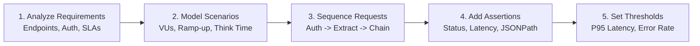

# GoMeter Test Plan Architect — Design & Sequencing Guide

GoMeter is a high-performance, modern Go-powered API testing and load testing tool. It replaces JMeter with clean, declarative YAML test plans, lightweight goroutines for thousands of virtual users, native assertions, dynamic token extraction, and real-time telemetry.

This skill guides AI coding assistants in translating user requirements into production-ready GoMeter test plans with proper request sequencing, dependency chaining, assertion rules, and SLA quality gates.

---

## 1. Core Workflow for Test Plan Creation

Follow these 5 steps when generating a test plan from user requirements:



### Step 1: Analyze Requirements
- **Target URL & Base Path**: e.g., `https://api.example.com/v1`
- **Authentication Mechanism**: Bearer JWT, API Key, Session Cookie, Basic Auth, OAuth2
- **Workflow / Flow Type**:
  - *Single Endpoint Benchmark*: High-concurrency throughput testing
  - *Dependent Multi-Step Flow*: Login ➔ Token Extract ➔ CRUD Operations ➔ Cleanup
  - *Data-Driven Test*: Parameterizing users or payloads via CSV files
- **Load Model**: Number of concurrent virtual users (`virtual_users`), total run duration (`duration`), ramp-up time (`ramp_up`), and pacing between iterations (`think_time`).
- **SLA Requirements**: Target P95/P99 latency limits and maximum allowable error rates.

### Step 2: Establish Test Plan Hierarchy
GoMeter test plans adhere to the following schema:
- `name`: Human-readable name of the test plan
- `description`: Purpose, scope, and target environment
- `version`: Plan schema version (`"1.0.0"`)
- `base_url`: Root API host/scheme
- `defaults`: Shared headers (`Content-Type`, `Accept`, `User-Agent`) and request timeout
- `variables`: Inline variables and CSV parameterization sources
- `scenarios`: Array of execution scenarios representing distinct user archetypes

---

## 2. Sequencing & Dependency API Tests (Chaining & Extraction)

In real-world applications, API requests depend on data produced by prior requests (e.g., extracting an authentication token or a created resource ID).

GoMeter provides the `extract` directive and `${var_name}` interpolation to enable robust request sequencing.

### Dependency Flow Pattern

```yaml
scenarios:
  - name: "Authenticated User Journey"
    virtual_users: 10
    duration: 30s
    ramp_up: 2s
    think_time: 250ms
    requests:
      # Step 1: Authenticate & Extract Token
      - name: "Login & Acquire Token"
        method: POST
        path: "/auth/login"
        body: '{"username": "${user_email}", "password": "${user_password}"}'
        assertions:
          - type: status
            expected: "200"
          - type: latency
            expected: "<500ms"
        extract:
          - name: auth_token
            source: body_json
            path: "$.data.token"
          - name: account_id
            source: body_json
            path: "$.data.user.id"

      # Step 2: Dependent Request (Chained Authorization & Account ID)
      - name: "Fetch User Profile"
        method: GET
        path: "/users/${account_id}/profile"
        headers:
          Authorization: "Bearer ${auth_token}"
        assertions:
          - type: status
            expected: "200"
          - type: body_contains
            expected: "profile"

      # Step 3: Dependent Resource Creation & ID Extraction
      - name: "Create Order"
        method: POST
        path: "/orders"
        headers:
          Authorization: "Bearer ${auth_token}"
        body: '{"account_id": "${account_id}", "amount": 99.50, "currency": "USD"}'
        assertions:
          - type: status
            expected: "201"
        extract:
          - name: created_order_id
            source: body_json
            path: "$.order.id"

      # Step 4: Verification using Created Resource ID
      - name: "Verify Order Details"
        method: GET
        path: "/orders/${created_order_id}"
        headers:
          Authorization: "Bearer ${auth_token}"
        assertions:
          - type: status
            expected: "200"
          - type: body_json
            path: "$.order.status"
            expected: "PENDING"
```

### Extraction Sources Supported by GoMeter
1. **`body_json`**: Extracts values from JSON response bodies using JSONPath:
   ```yaml
   extract:
     - name: token
       source: body_json
       path: "$.token"
   ```
2. **`header`**: Extracts values from response headers:
   ```yaml
   extract:
     - name: session_id
       source: header
       path: "X-Session-ID"
   ```
3. **`regex`**: Extracts values matching regular expressions:
   ```yaml
   extract:
     - name: csrf_token
       source: regex
       pattern: 'name="_csrf" value="([^"]+)"'
   ```

---

## 3. Data-Driven Testing (CSV Parameterization)

For tests where each virtual user needs unique credentials or inputs (e.g. 100 different test users):

```yaml
variables:
  inline:
    env: "staging"
  csv:
    - name: user_credentials
      file: "./data/users.csv"
      delimiter: ","

defaults:
  headers:
    Content-Type: "application/json"
    X-Environment: "${env}"

scenarios:
  - name: "CSV Data-Driven Authentication"
    virtual_users: 20
    duration: 1m
    requests:
      - name: "Login As User"
        method: POST
        path: "/api/login"
        body: '{"username": "${username}", "password": "${password}"}'
        assertions:
          - type: status
            expected: "200"
```

> [!TIP]
> The CSV header row determines the variable names (e.g. `username,password,role`). In requests, reference them as `${username}`, `${password}`, `${role}`.
> File paths are resolved relative to the test plan's directory.

---

## 4. Assertion Types & Best Practices

Always include assertions to convert silent HTTP errors into explicit test failures:

| Assertion Type | Syntax / Example | Purpose |
|---|---|---|
| **Status Code** | `type: status`<br/>`expected: "200"` | Confirms HTTP response status (200, 201, 204, etc.) |
| **Response Latency** | `type: latency`<br/>`expected: "<500ms"` | Fails the request if latency exceeds threshold |
| **JSONPath Match** | `type: body_json`<br/>`path: "$.status"`<br/>`expected: "success"` | Validates specific fields in structured JSON |
| **Body Substring** | `type: body_contains`<br/>`expected: "Welcome"` | Checks for presence of string in response body |

---

## 5. SLA Quality Gates & Thresholds

Add thresholds at the scenario level to guarantee system performance compliance:

```yaml
scenarios:
  - name: "Catalog Browsing"
    virtual_users: 50
    duration: 2m
    requests:
      # ...
    thresholds:
      - metric: p95_latency
        operator: "<"
        value: 500
        unit: ms
      - metric: p99_latency
        operator: "<"
        value: 1200
        unit: ms
      - metric: error_rate
        operator: "<"
        value: 1.0
        unit: "%"
      - metric: min_throughput
        operator: ">"
        value: 150
        unit: "rps"
```

---

## 6. Sizing Recommendations for Virtual Users & Pacing

- **Smoke & Functional API Verification**:
  - `virtual_users: 1` to `3`
  - `duration: 5s` to `15s`
  - Purpose: Validates that endpoint sequencing, token extraction, and assertions function correctly.
- **Realistic Concurrency / Load Testing**:
  - `virtual_users: 10` to `50`
  - `ramp_up: 5s` to `15s` (gradually spins up virtual users)
  - `think_time: 200ms` to `500ms` (realistic human pause between calls)
  - `duration: 30s` to `2m`
- **Stress & Breaking Point Testing**:
  - `virtual_users: 100` to `500+`
  - `ramp_up: 30s`
  - `think_time: 50ms` (aggressive hammering)

---

## 7. Saving & Running the Test Plan

1. Save the file with the `.gometer.yaml` extension (e.g. `tests/auth-flow.gometer.yaml`).
2. Validate syntax using the GoMeter CLI or VS Code CodeLens:
   ```bash
   gometer validate tests/auth-flow.gometer.yaml
   ```
3. Execute the test:
   ```bash
   gometer run tests/auth-flow.gometer.yaml --output all
   ```
4. View live metrics in the VS Code GoMeter Dashboard or export results as CSV directly from the Test Plans tree view.
